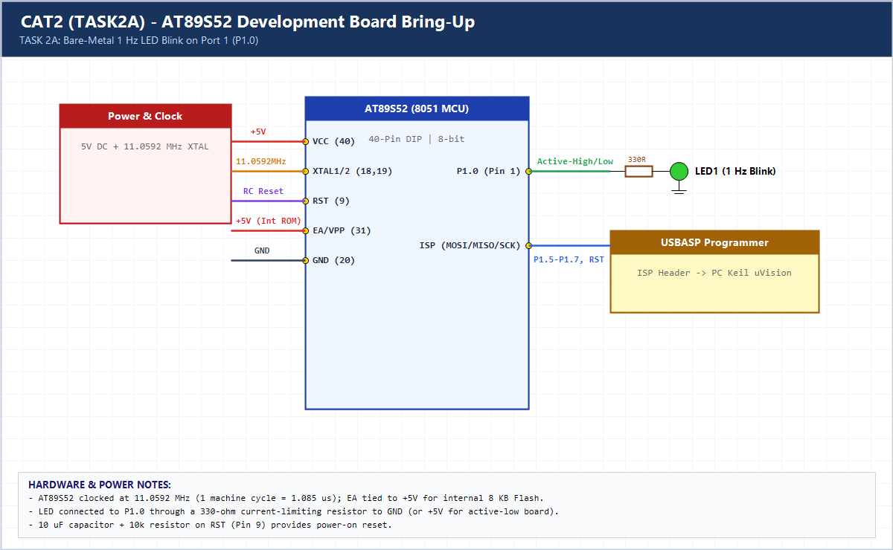

# EXPERIMENT DETAILS

**EXP:** CONTINUOUS ASSESSMENT 2 (CAT2)

**DATE:** 20/07/2026

**NAME OF EXP:** 8051 Tool Chain setup - Development Board - AT89S52

**HARDWARE SETUP / PLATFORM:** AT89S52 (8051 Core, 11.0592 MHz) + Keil C51 uVision

---

## TASK 2A : Bare-Metal LED Blink

### 1. Hardware Setup & Circuit Diagram

- **MCU:** AT89S52 (8-bit 8051 Architecture)
- **Clock:** 11.0592 MHz Crystal Oscillator
- **Operating Voltage:** 5V DC
- **Debug / Programming Interface:** USBASP ISP (MOSI, MISO, SCK, RST)
- **LED GPIO Port / Pin:** Port 1, Pin P1.0 (with 330-ohm resistor)
- **Target Frequency:** ~1 Hz (500 ms ON, 500 ms OFF)

### 2. Core Logic / Pseudocode / Code Base

**Working Principle:**

The AT89S52 microcontroller directly writes to the bit-addressable Port 1 latch (`P1^0`) via `<reg51.h>` without any HAL or OS layer. Nested loops generate approximately 500 ms ON and 500 ms OFF intervals, producing a 1 Hz blink.

**Pseudocode:**

1. Include `<reg51.h>` for AT89S52 SFR definitions.
2. Map `LED` to bit `P1^0`.
3. Initialize Port 1 to `0x00`.
4. In an infinite loop, set `LED = 1`, wait ~500 ms, clear `LED = 0`, wait ~500 ms.

**Code Base:**

- `sbit LED = P1^0;` accesses bit 0 of Port 1 SFR (`0x90`).
- `delay_500ms()` creates an approximate 0.5 s delay using nested `for` loops.

> **Build Note:** Rebuild `TASK2A.uvproj` in Keil uVision (C51) to regenerate the full target binary in `Objects/TASK2A.hex` before flashing onto the AT89S52 board.

### 3. Inference

The board bring-up was verified via multimeter power-rail checks and ISP programming; the LED connected to `P1.0` blinks steadily at approximately 1 Hz using pure bare-metal register access.
