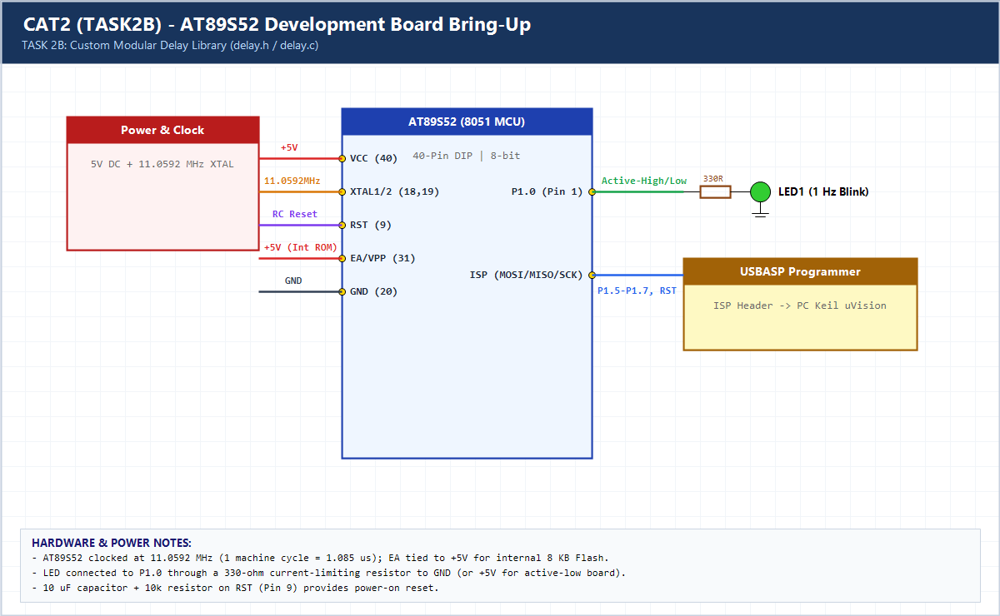

# EXPERIMENT DETAILS

**EXP:** CONTINUOUS ASSESSMENT 2 (CAT2)

**DATE:** 20/07/2026

**NAME OF EXP:** 8051 Tool Chain setup - Development Board - AT89S52

**HARDWARE SETUP / PLATFORM:** AT89S52 (8051 Core, 11.0592 MHz) + Keil C51 uVision

---

## TASK 2B : Custom Delay Library Function

### 1. Hardware Setup & Circuit Diagram

- **MCU:** AT89S52 (8051 Core)
- **Operating Voltage:** 5V DC
- **Clock:** 11.0592 MHz Crystal
- **LED Pin:** `P1.0` via 330-ohm current-limiting resistor

### 2. Core Logic / Pseudocode / Code Base

**Working Principle:**

Delay logic is decoupled into a reusable custom module (`delay.h` and `delay.c`) providing `delay_ms()` and `delay_us()` functions. `main.c` includes `delay.h` to toggle `P1.0` at 1 Hz cleanly.

**Pseudocode:**

1. Define `delay_ms(ms)` and `delay_us(us)` prototypes in `delay.h`.
2. Implement calibrated nested-loop delays in `delay.c`.
3. Include `delay.h` in `main.c` and toggle `P1.0` every 500 ms.

**Code Base:**

- `delay.h` / `delay.c`: Modular custom delay library reusable across 8051 experiments.
- `main.c`: Calls `delay_ms(500)` for 1 Hz LED blinking on `P1.0`.

> **Build Note:** Rebuild `TASK2B.uvproj` in Keil uVision (C51) to regenerate the full target binary in `Objects/TASK2B.hex` before flashing onto the AT89S52 board.

### 3. Inference

Separating timing routines into a dedicated `delay` library improves code modularity, readability, and reuse across subsequent AT89S52 lab tasks.
