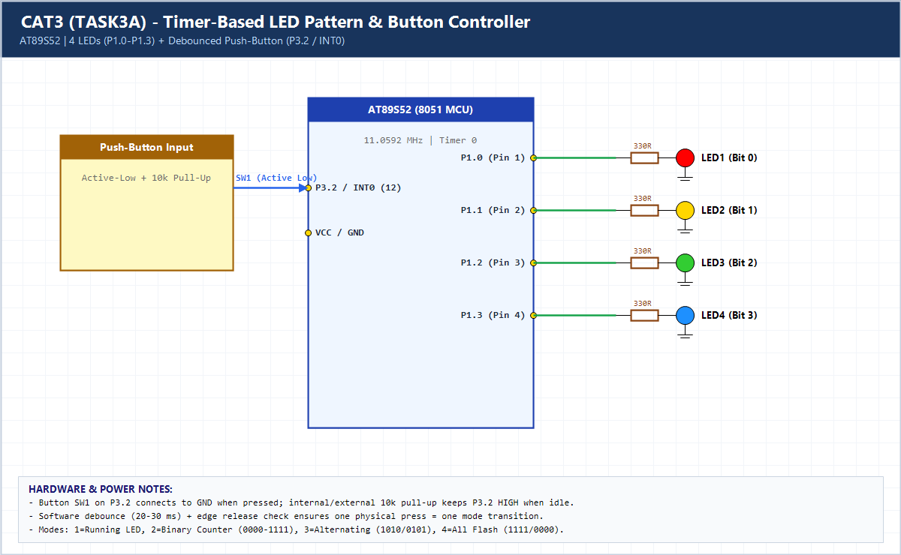

# EXPERIMENT DETAILS

**EXP:** CONTINUOUS ASSESSMENT 3 (CAT3)

**DATE:** 27/07/2026

**NAME OF EXP:** Timer-Based LED Pattern Generator and Button Interrupt Controller

**HARDWARE SETUP / PLATFORM:** AT89S52 (8051 Core, 11.0592 MHz) + Keil C51 uVision

---

## TASK 3A : Four-State LED Pattern Controller with Debounced Button

### 1. Hardware Setup & Circuit Diagram

- **MCU:** AT89S52 (11.0592 MHz)
- **LED Outputs:** `P1.0`, `P1.1`, `P1.2`, `P1.3` (4 LEDs via 330-ohm resistors)
- **Push-Button Input:** `P3.2` (`INT0`) active-low with pull-up resistor
- **Timer:** Hardware Timer 0 Mode 1 generating 1 ms tick interrupts

### 2. Core Logic / Pseudocode / Code Base

**Working Principle:**

Initially all LEDs on `P1.0–P1.3` are OFF (`mode = 0`). Each valid debounced button press on `P3.2` advances the state machine cleanly across 4 modes: Running LED, 4-bit Binary Counter (`0000`–`1111`), Alternating Pattern (`1010`/`0101`), and All-LED Flash (`1111`/`0000`).

**Pseudocode:**

1. Configure `P1.0–P1.3` as output (initially `0x00`) and `P3.2` as input.
2. Initialize Timer 0 (`TH0=0xFC, TL0=0x66`) for 1 ms interrupt ticks.
3. Poll `BTN` (`P3.2`); when pressed, wait ~25 ms debounce, increment `mode` (1..4), and wait for release.
4. Every 250 ms, update `P1` according to the active `mode`.

**Code Base:**

- `timer0_isr()`: Reloads `0xFC66` and increments `tick_ms` every 1 ms.
- `check_button()`: Enforces single state transition per physical press via debounce and release-wait.

> **Build Note:** Rebuild `TASK3A.uvproj` in Keil uVision (C51) to regenerate the full target binary in `Objects/TASK3A.hex` before flashing onto the AT89S52 board.

### 3. Inference

Combining a Timer 0 timebase with debounced state transitions reliably eliminates mechanical switch bounce and produces deterministic 4-mode LED UI patterns.
