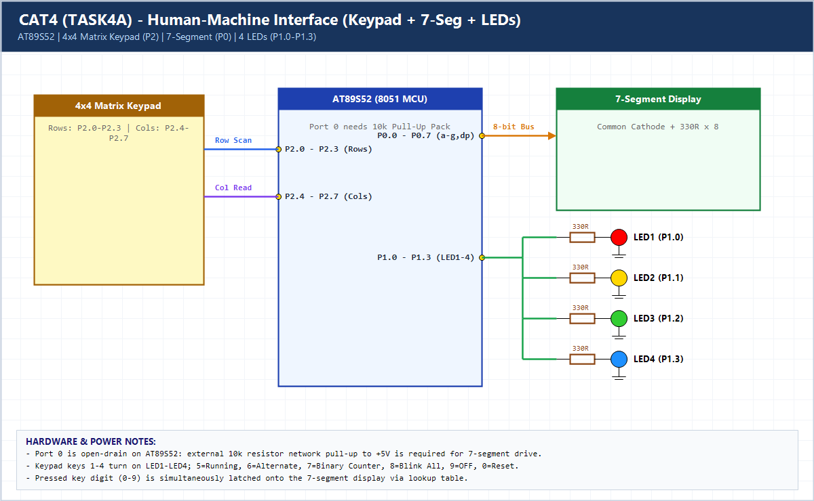

# EXPERIMENT DETAILS

**EXP:** CONTINUOUS ASSESSMENT 4 (CAT4)

**DATE:** 03/08/2026

**NAME OF EXP:** Human-Machine Interface using Matrix Keypad, LEDs, and Seven-Segment Display

**HARDWARE SETUP / PLATFORM:** AT89S52 (8051 Core, 11.0592 MHz) + Keil C51 uVision

---

## TASK 4A : Keypad-Driven Seven-Segment & LED Mode Controller

### 1. Hardware Setup & Circuit Diagram

- **MCU:** AT89S52 (11.0592 MHz)
- **4x4 Matrix Keypad:** Port 2 (`P2.0–P2.3` rows, `P2.4–P2.7` columns)
- **Seven-Segment Display:** Port 0 (`P0.0–P0.7` with external 10k pull-up resistor pack + 330-ohm resistors)
- **4 LEDs:** Port 1 (`P1.0–P1.3`)

### 2. Core Logic / Pseudocode / Code Base

**Working Principle:**

Row-column scanning detects digits `0–9` on the 4x4 keypad, displays the pressed digit on the 7-segment display via `display_digit()`, and executes the mapped LED behavior (`1–4`: single LED, `5`: running, `6`: alternate `1010/0101`, `7`: binary counter `0–15`, `8`: blink all, `9`: all OFF, `0`: system reset).

**Pseudocode:**

1. Initialize `P0` (`0`), `P1` (`0x00`), `P2` (`0xFF`).
2. Call `keypad_scan()` continuously; on valid key press, update `active_mode` and call `display_digit(key)`.
3. Call `led_control(active_mode)` which dispatches to single LED control or `running_led()`, `alternate_led()`, `binary_counter()`, `blink_all()`.

**Code Base:**

- `keypad_scan()`, `display_digit()`, `led_control()`, `running_led()`, `binary_counter()`, `alternate_led()`, `blink_all()` implemented per modular specification.

> **Build Note:** Rebuild `TASK4A.uvproj` in Keil uVision (C51) to regenerate the full target binary in `Objects/TASK4A.hex` before flashing onto the AT89S52 board.

### 3. Inference

The HMI successfully integrates matrix keypad scanning, 7-segment lookup decoding on open-drain Port 0, and multi-pattern LED feedback.
