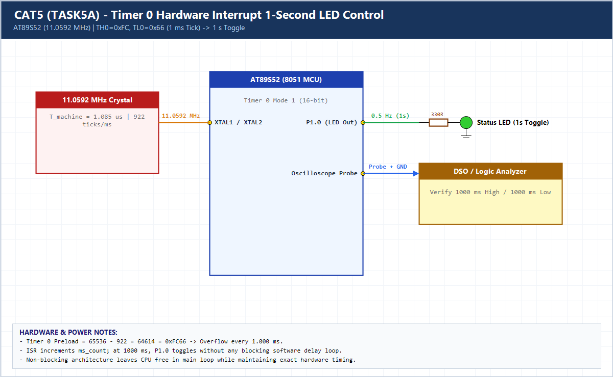

# EXPERIMENT DETAILS

**EXP:** CONTINUOUS ASSESSMENT 5 (CAT5)

**DATE:** 10/08/2026

**NAME OF EXP:** Hardware Timer and Interrupt-Based Timing for LED Fading, Pulse Generation, and Stepper Motor Control

**HARDWARE SETUP / PLATFORM:** AT89S52 (11.0592 MHz) + Keil C51 uVision + Oscilloscope

---

## TASK 5A : Timer 0 1-Second Periodic Interrupt LED Control

### 1. Hardware Setup & Circuit Diagram

- **MCU:** AT89S52 @ 11.0592 MHz (`T_machine = 1.085 us`)
- **Timer Reload:** `65536 - 922 = 64614 = 0xFC66` (`1 ms` overflow)
- **Output Pin:** `P1.0` (LED + Oscilloscope Ch1 probe)

### 2. Core Logic / Pseudocode / Code Base

**Working Principle:**

Timer 0 operates in 16-bit Mode 1 with reload `0xFC66` to generate a precise 1 ms interrupt. Inside `timer0_isr()`, `ms_ticks` counts to `1000` and toggles `P1.0` every 1.000 second with zero blocking software loops.

**Pseudocode:**

1. Configure `TMOD` for Timer 0 Mode 1 and load `TH0 = 0xFC, TL0 = 0x66`.
2. Enable `ET0`, `EA`, and start `TR0 = 1`.
3. In ISR, reload `0xFC66`, increment `ms_ticks`, and toggle `LED` when `ms_ticks == 1000`.

**Code Base:**

- `timer0_isr() interrupt 1`: Maintains exact 1 ms hardware timebase and 1 s toggle.

> **Build Note:** Rebuild `TASK5A.uvproj` in Keil uVision (C51) to regenerate the full target binary in `Objects/TASK5A.hex` before flashing onto the AT89S52 board.

### 3. Inference

Hardware timer interrupts provide jitter-free 1-second timing verified on an oscilloscope while keeping the CPU non-blocked.
