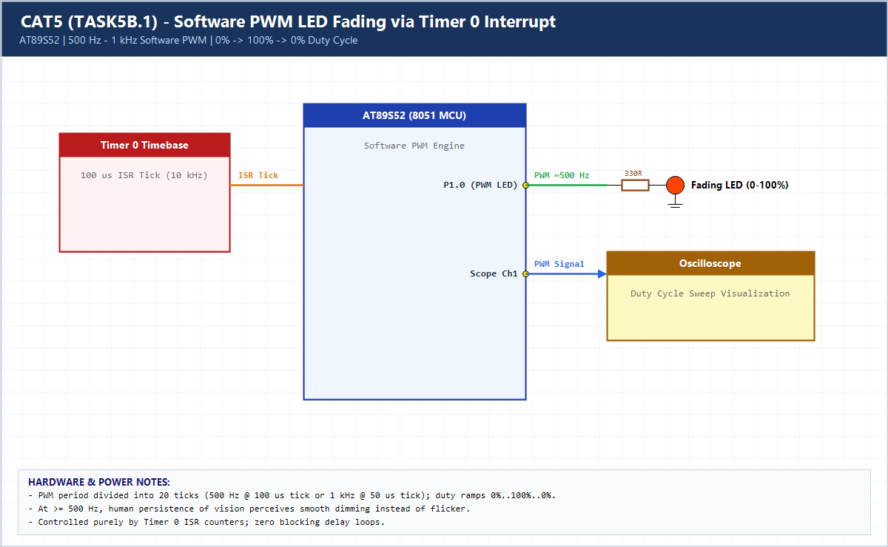

# EXPERIMENT DETAILS

**EXP:** CONTINUOUS ASSESSMENT 5 (CAT5)

**DATE:** 10/08/2026

**NAME OF EXP:** Hardware Timer and Interrupt-Based Timing for LED Fading, Pulse Generation, and Stepper Motor Control

**HARDWARE SETUP / PLATFORM:** AT89S52 (11.0592 MHz) + Keil C51 uVision

---

## TASK 5B.1 : LED Fading Using Software PWM (Timer 0 Interrupt)

### 1. Hardware Setup & Circuit Diagram

- **MCU:** AT89S52 @ 11.0592 MHz
- **PWM Pin:** `P1.0` driving LED via 330-ohm resistor
- **PWM Carrier Frequency:** ~500 Hz (`100 us` Timer 0 auto-reload x 20 steps)

### 2. Core Logic / Pseudocode / Code Base

**Working Principle:**

Timer 0 Mode 2 generates a 100 us interrupt (`10 kHz`). A 20-step software counter creates a 500 Hz PWM signal on `P1.0` while ramping `duty_steps` smoothly from `0%` to `100%` and back to `0%`.

**Pseudocode:**

1. Configure Timer 0 Mode 2 with reload `256 - 92` (~100 us).
2. In ISR, increment `pwm_tick` modulo 20; drive `PWM_LED = 1` when `pwm_tick < duty_steps`.
3. Every 500 ticks (50 ms), ramp `duty_steps` up to 20 then down to 0.

**Code Base:**

- Timer 0 Mode 2 eliminates manual reload jitter at high interrupt frequencies.

> **Build Note:** Rebuild `TASK5B_1.uvproj` in Keil uVision (C51) to regenerate the full target binary in `Objects/TASK5B_1.hex` before flashing onto the AT89S52 board.

### 3. Inference

At 500 Hz carrier frequency, varying the software PWM duty cycle produces smooth perceptual LED fading without visible flicker.
