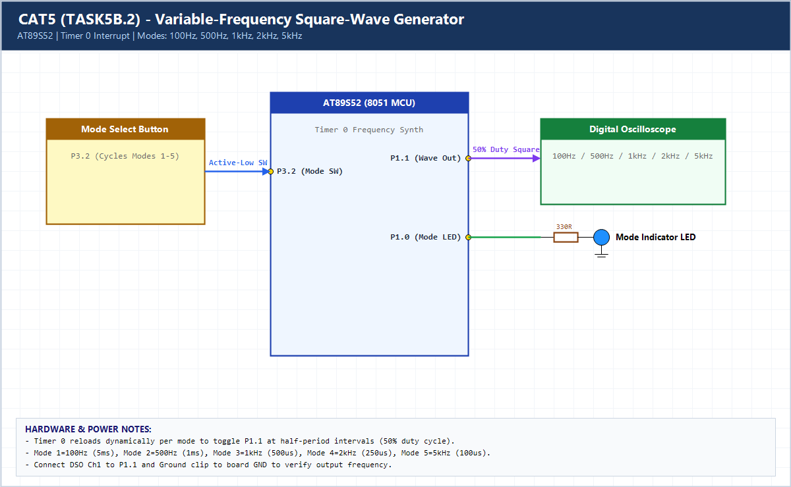

# EXPERIMENT DETAILS

**EXP:** CONTINUOUS ASSESSMENT 5 (CAT5)

**DATE:** 10/08/2026

**NAME OF EXP:** Hardware Timer and Interrupt-Based Timing for LED Fading, Pulse Generation, and Stepper Motor Control

**HARDWARE SETUP / PLATFORM:** AT89S52 (11.0592 MHz) + Keil C51 uVision + Oscilloscope

---

## TASK 5B.2 : Variable-Frequency Square-Wave Generator

### 1. Hardware Setup & Circuit Diagram

- **MCU:** AT89S52 @ 11.0592 MHz
- **Signal Output Pin:** `P1.1` -> Oscilloscope Ch1
- **Mode Selector Button:** `P3.2` cycling Modes 1–5 (100 Hz, 500 Hz, 1 kHz, 2 kHz, 5 kHz)

### 2. Core Logic / Pseudocode / Code Base

**Working Principle:**

Timer 0 Mode 1 toggles `P1.1` at exact half-period intervals selected from a lookup table (`th_table`, `tl_table`). Pressing `P3.2` cycles through 100 Hz, 500 Hz, 1 kHz, 2 kHz, and 5 kHz square-wave outputs.

**Pseudocode:**

1. Precompute 16-bit Timer 0 reloads for 50% duty half-periods of 100 Hz..5 kHz.
2. In Timer 0 ISR, reload `TH0/TL0` for `freq_mode` and invert `WAVE_OUT`.
3. Poll `MODE_BTN` with debouncing to increment `freq_mode` modulo 5.

**Code Base:**

- Lookup tables `th_table[]` and `tl_table[]` avoid runtime division inside the ISR.

> **Build Note:** Rebuild `TASK5B_2.uvproj` in Keil uVision (C51) to regenerate the full target binary in `Objects/TASK5B_2.hex` before flashing onto the AT89S52 board.

### 3. Inference

Dynamic Timer 0 reload tables enable accurate multi-frequency 50% duty-cycle square-wave generation across 100 Hz to 5 kHz.
