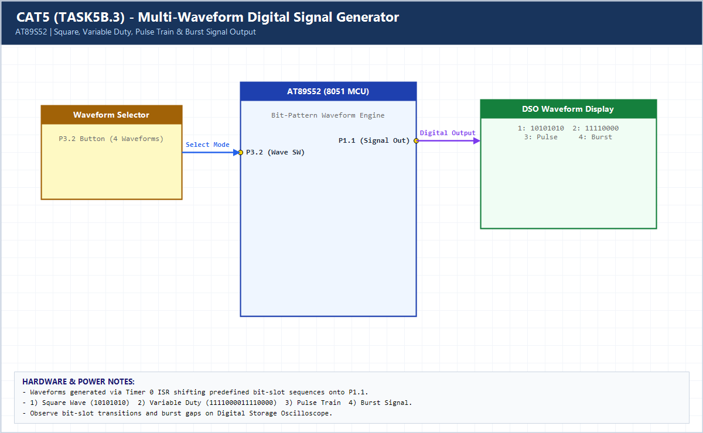

# EXPERIMENT DETAILS

**EXP:** CONTINUOUS ASSESSMENT 5 (CAT5)

**DATE:** 10/08/2026

**NAME OF EXP:** Hardware Timer and Interrupt-Based Timing for LED Fading, Pulse Generation, and Stepper Motor Control

**HARDWARE SETUP / PLATFORM:** AT89S52 (11.0592 MHz) + Keil C51 uVision + Oscilloscope

---

## TASK 5B.3 : Multi-Waveform Signal Generator (Square, Duty, Pulse, Burst)

### 1. Hardware Setup & Circuit Diagram

- **MCU:** AT89S52 @ 11.0592 MHz
- **Signal Output:** `P1.1` -> Oscilloscope Ch1
- **Waveform Selector:** `P3.2` button cycles Square / Variable Duty / Pulse Train / Burst Signal

### 2. Core Logic / Pseudocode / Code Base

**Working Principle:**

Each waveform is encoded as a 24-bit slot pattern shifted out MSB-first onto `P1.1` every 500 us by Timer 0 ISR, supporting Square Wave, Variable Duty-Cycle Wave, Pulse Train, and Burst Signal.

**Pseudocode:**

1. Store 24-bit waveform masks in ROM (`code` array).
2. Every 500 us Timer 0 interrupt, output bit `(23 - bit_idx)` to `P1.1` and advance `bit_idx`.
3. Switch `wave_mode` on debounced button press.

**Code Base:**

- `waveforms[4]` encodes all four digital signal types cleanly in a single parameterized ISR.

> **Build Note:** Rebuild `TASK5B_3.uvproj` in Keil uVision (C51) to regenerate the full target binary in `Objects/TASK5B_3.hex` before flashing onto the AT89S52 board.

### 3. Inference

Bit-slotted timer serialization enables arbitrary digital waveforms (square, duty-cycled, pulse train, burst) on a single GPIO pin.
