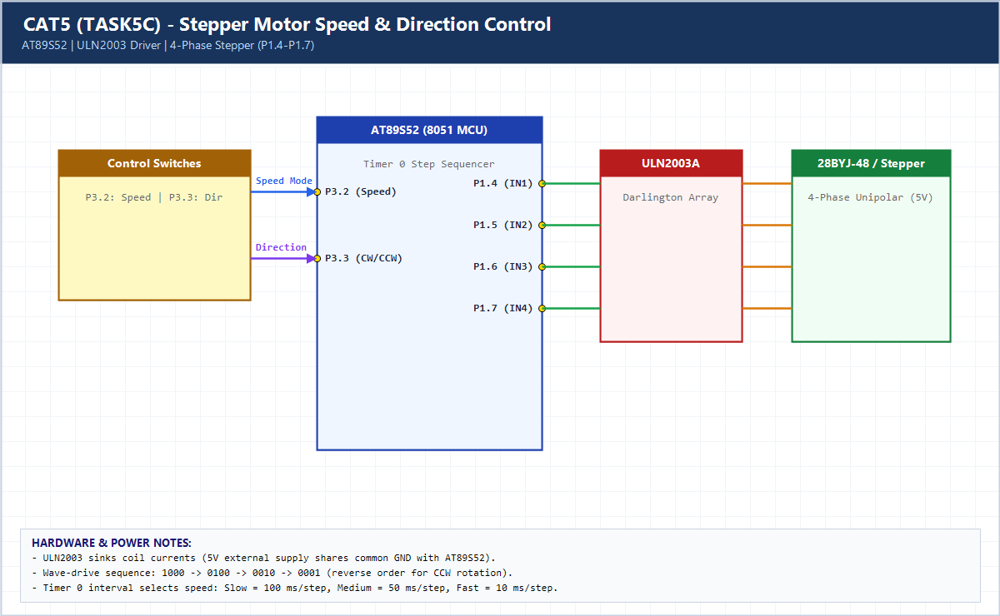

# EXPERIMENT DETAILS

**EXP:** CONTINUOUS ASSESSMENT 5 (CAT5)

**DATE:** 10/08/2026

**NAME OF EXP:** Hardware Timer and Interrupt-Based Timing for LED Fading, Pulse Generation, and Stepper Motor Control

**HARDWARE SETUP / PLATFORM:** AT89S52 (11.0592 MHz) + ULN2003 Driver + 4-Phase Stepper Motor

---

## TASK 5C : Stepper Motor Speed and Direction Control

### 1. Hardware Setup & Circuit Diagram

- **MCU:** AT89S52 @ 11.0592 MHz
- **Stepper Driver:** ULN2003A Darlington Array driven by `P1.4–P1.7`
- **Controls:** `P3.2` cycles speed (100 ms / 50 ms / 10 ms per step); `P3.3` toggles CW/CCW direction

### 2. Core Logic / Pseudocode / Code Base

**Working Principle:**

Timer 0 generates a 1 ms tick. Whenever `ms_count` reaches the selected interval (`100`, `50`, or `10 ms`), the ISR advances or reverses `step_idx` through `{1000, 0100, 0010, 0001}` on `P1.4–P1.7`.

**Pseudocode:**

1. Initialize Timer 0 for 1 ms interrupts and set `P1.4–P1.7` as stepper coil outputs.
2. On each `speed_ms[speed_idx]` elapsed, increment (CW) or decrement (CCW) `step_idx` and write `step_seq[step_idx]`.
3. Poll `BTN_SPEED` and `BTN_DIR` with debouncing to change step rate and direction.

**Code Base:**

- Uses ULN2003 current sink driver to isolate AT89S52 GPIO pins from inductive motor coil currents.

> **Build Note:** Rebuild `TASK5C.uvproj` in Keil uVision (C51) to regenerate the full target binary in `Objects/TASK5C.hex` before flashing onto the AT89S52 board.

### 3. Inference

Interrupt-driven step sequencing allows smooth speed transitions (Slow/Medium/Fast) and instant CW/CCW reversal without blocking.
