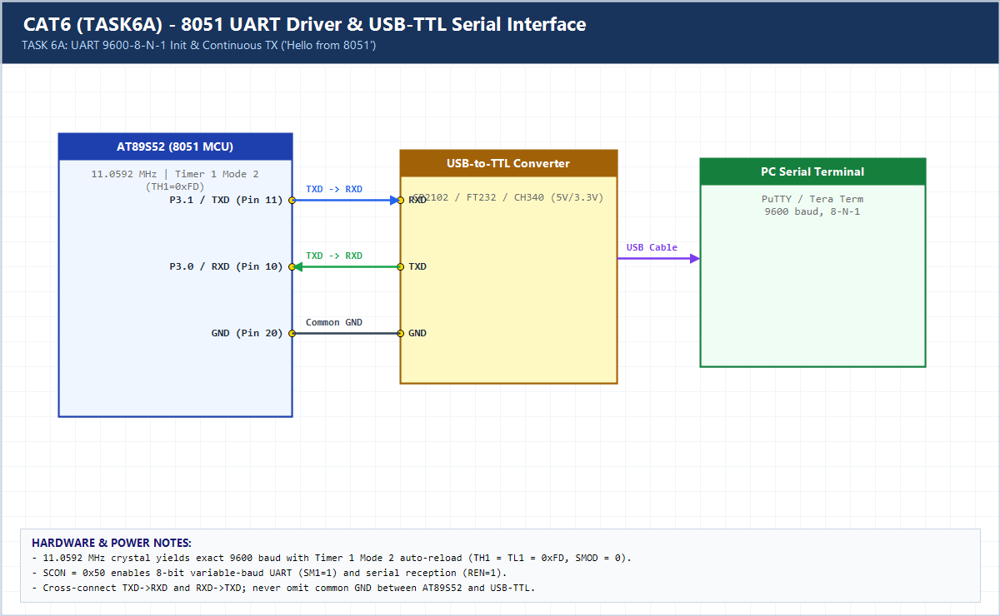

# EXPERIMENT DETAILS

**EXP:** CONTINUOUS ASSESSMENT 6 (CAT6)

**DATE:** 17/08/2026

**NAME OF EXP:** UART Driver and Serial Debugging

**HARDWARE SETUP / PLATFORM:** AT89S52 (11.0592 MHz) + USB-to-TTL Converter + PuTTY

---

## TASK 6A : UART Initialization and Character Transmission (9600-8-N-1)

### 1. Hardware Setup & Circuit Diagram

- **MCU:** AT89S52 @ 11.0592 MHz
- **UART Pins:** `P3.1` (`TXD`) -> USB-TTL `RXD`, `P3.0` (`RXD`) <- USB-TTL `TXD`, Common `GND`
- **Serial Config:** 9600 baud, 8 data bits, No parity, 1 stop bit (`TH1 = 0xFD`, `SCON = 0x50`)

### 2. Core Logic / Pseudocode / Code Base

**Working Principle:**

Timer 1 Mode 2 auto-reload (`TH1 = 0xFD`) generates exact 9600 baud with an 11.0592 MHz crystal. `SCON = 0x50` configures 8-bit asynchronous UART Mode 1. `uart_tx_string()` transmits `"Hello from 8051\r\n"` to PuTTY every second.

**Pseudocode:**

1. Configure `TMOD |= 0x20`, `TH1 = 0xFD`, `SCON = 0x50`, `TR1 = 1`.
2. Write character to `SBUF`, poll `TI == 1`, then clear `TI = 0`.
3. Loop continuously sending `"Hello from 8051\r\n"` every 1 second.

**Code Base:**

- `uart_init()`, `uart_tx_char()`, `uart_tx_string()` implement bare-metal AT89S52 serial transmission.

> **Build Note:** Rebuild `TASK6A.uvproj` in Keil uVision (C51) to regenerate the full target binary in `Objects/TASK6A.hex` before flashing onto the AT89S52 board.

### 3. Inference

Using an 11.0592 MHz crystal yields 0% baud-rate error at 9600 bps, producing clean, readable serial output in PuTTY.
