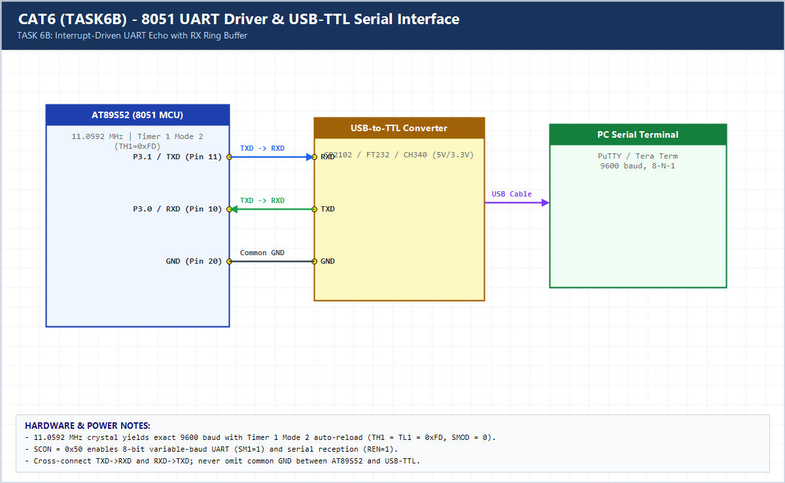

# EXPERIMENT DETAILS

**EXP:** CONTINUOUS ASSESSMENT 6 (CAT6)

**DATE:** 17/08/2026

**NAME OF EXP:** UART Driver and Serial Debugging

**HARDWARE SETUP / PLATFORM:** AT89S52 (11.0592 MHz) + USB-to-TTL Converter + PuTTY

---

## TASK 6B : Interrupt-Driven UART Echo with RX Ring Buffer

### 1. Hardware Setup & Circuit Diagram

- **MCU:** AT89S52 @ 11.0592 MHz
- **UART Pins:** `P3.1` (`TXD`), `P3.0` (`RXD`), Common `GND` -> USB-TTL
- **Interrupts:** Serial Interrupt Vector 4 (`ES = 1, EA = 1`) + 32-byte RX Ring Buffer

### 2. Core Logic / Pseudocode / Code Base

**Working Principle:**

Incoming bytes trigger the UART ISR (`RI == 1`) and are pushed into a 32-byte circular ring buffer without losing rapid keystrokes. The main loop pops bytes from the tail and echoes them back to PuTTY via interrupt-cleared `TI`.

**Pseudocode:**

1. Initialize UART at 9600-8-N-1 and enable `ES` and `EA`.
2. In `uart_isr()` (`interrupt 4`), on `RI`: read `SBUF`, clear `RI`, store in `rx_buf[rx_head]` if not full.
3. In `uart_isr()`, on `TI`: clear `TI` and set `tx_busy = 0`.
4. In `main()`, while `rx_tail != rx_head`, dequeue byte and echo via `SBUF`.

**Code Base:**

- Ring buffer (`rx_head`, `rx_tail`) decouples asynchronous RX bursts from main-loop processing.

> **Build Note:** Rebuild `TASK6B.uvproj` in Keil uVision (C51) to regenerate the full target binary in `Objects/TASK6B.hex` before flashing onto the AT89S52 board.

### 3. Inference

An interrupt-driven RX ring buffer prevents character loss during fast typing or multi-character strings such as `ABC123` or `Hello 8051`.
