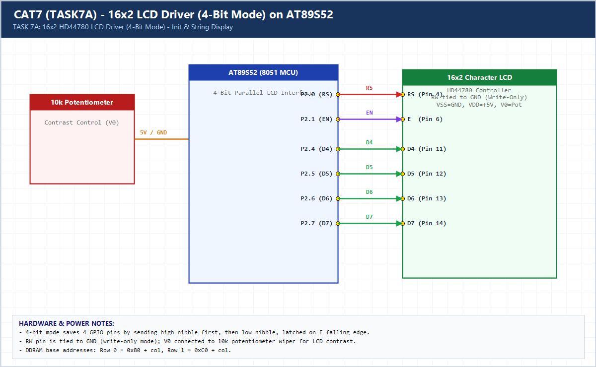

# EXPERIMENT DETAILS

**EXP:** CONTINUOUS ASSESSMENT 7 (CAT7)

**DATE:** 24/08/2026

**NAME OF EXP:** 16x2 LCD Driver Development and Dynamic Display Control

**HARDWARE SETUP / PLATFORM:** AT89S52 (11.0592 MHz) + HD44780 16x2 LCD

---

## TASK 7A : 4-Bit LCD Initialization and Character/String Display

### 1. Hardware Setup & Circuit Diagram

- **MCU:** AT89S52 @ 11.0592 MHz
- **LCD Pins (4-bit mode):** `RS = P2.0`, `EN = P2.1`, `RW = GND`, `D4–D7 = P2.4–P2.7`
- **Contrast:** `V0` via 10k potentiometer between `+5V` and `GND`

### 2. Core Logic / Pseudocode / Code Base

**Working Principle:**

Derives the HD44780 4-bit initialization sequence (`0x33, 0x32, 0x28, 0x0C, 0x06, 0x01`), sends upper then lower nibbles on `P2.4–P2.7` latched on the falling edge of `EN`, and renders characters and strings on both rows.

**Pseudocode:**

1. Wait 20 ms after power-on and send 4-bit wake-up sequence (`0x30` x3, then `0x20`).
2. Send Function Set `0x28`, Display Control `0x0C`, Entry Mode `0x06`, Clear `0x01`.
3. Set DDRAM address `0x80` (Row 1) and `0xC0` (Row 2) and write characters via `lcd_data()`.

**Code Base:**

- `lcd_init()`, `lcd_cmd()`, `lcd_data()`, `lcd_puts()` split cleanly into `lcd.h` and `lcd.c`.

> **Build Note:** Rebuild `TASK7A.uvproj` in Keil uVision (C51) to regenerate the full target binary in `Objects/TASK7A.hex` before flashing onto the AT89S52 board.

### 3. Inference

4-bit interfacing reduces GPIO pin usage from 11 pins to 6 while preserving full HD44780 command and DDRAM control.
