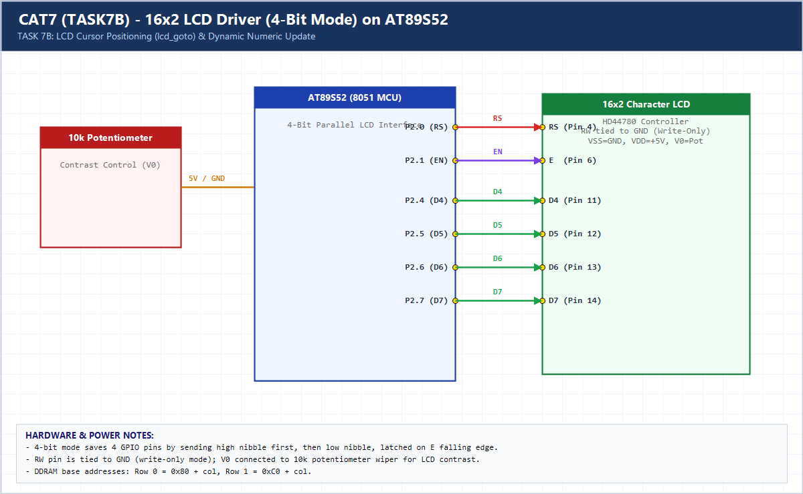

# EXPERIMENT DETAILS

**EXP:** CONTINUOUS ASSESSMENT 7 (CAT7)

**DATE:** 24/08/2026

**NAME OF EXP:** 16x2 LCD Driver Development and Dynamic Display Control

**HARDWARE SETUP / PLATFORM:** AT89S52 (11.0592 MHz) + HD44780 16x2 LCD

---

## TASK 7B : Cursor Positioning and Dynamic Value Update

### 1. Hardware Setup & Circuit Diagram

- **MCU:** AT89S52 @ 11.0592 MHz
- **LCD Interface:** `RS=P2.0`, `EN=P2.1`, `RW=GND`, `D4–D7=P2.4–P2.7`

### 2. Core Logic / Pseudocode / Code Base

**Working Principle:**

Implements `lcd_goto(row, col)` using HD44780 DDRAM offsets (`0x80` for row 0, `0xC0` for row 1), `lcd_puts()`, and `lcd_print_number()` to update a live numeric value in-place without clearing the whole screen.

**Pseudocode:**

1. Map `(row, col)` to `0x80 + col` or `0xC0 + col` in `lcd_goto()`.
2. Convert unsigned integer digits to ASCII in reverse and print in `lcd_print_number()`.
3. Update Row 1 counter value every 500 ms without flicker.

**Code Base:**

- Required API: `lcd_goto(row, column)`, `lcd_puts(string)`, `lcd_print_number(value)`.

> **Build Note:** Rebuild `TASK7B.uvproj` in Keil uVision (C51) to regenerate the full target binary in `Objects/TASK7B.hex` before flashing onto the AT89S52 board.

### 3. Inference

Targeted DDRAM cursor addressing eliminates full-screen clear flicker during dynamic telemetry updates.
