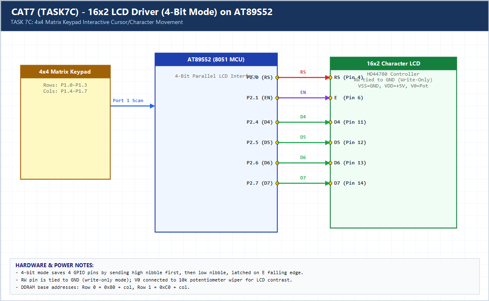

# EXPERIMENT DETAILS

**EXP:** CONTINUOUS ASSESSMENT 7 (CAT7)

**DATE:** 24/08/2026

**NAME OF EXP:** 16x2 LCD Driver Development and Dynamic Display Control

**HARDWARE SETUP / PLATFORM:** AT89S52 (11.0592 MHz) + 4x4 Matrix Keypad + HD44780 16x2 LCD

---

## TASK 7C : 4x4 Keypad-Based Character Movement on 16x2 LCD

### 1. Hardware Setup & Circuit Diagram

- **MCU:** AT89S52 @ 11.0592 MHz
- **16x2 LCD:** Port 2 (`RS=P2.0`, `EN=P2.1`, `D4–D7=P2.4–P2.7`, `RW=GND`)
- **4x4 Keypad:** Port 1 (`P1.0–P1.3` rows, `P1.4–P1.7` columns)
- **Controls:** `2` = Up, `8` = Down, `4` = Left, `6` = Right

### 2. Core Logic / Pseudocode / Code Base

**Working Principle:**

Tracks `(row, col)` coordinates within the 2x16 DDRAM grid (`row` 0..1, `col` 0..15). Pressing `2`, `8`, `4`, or `6` on the 4x4 keypad erases the previous `*` with a space and redraws it at the updated coordinate.

**Pseudocode:**

1. Initialize LCD and draw `*` at `(0, 0)`.
2. Poll `keypad_scan()` on Port 1.
3. On key `2` (Up), `8` (Down), `4` (Left), `6` (Right): clear old cell, clamp new `(row, col)`, and draw `*`.

**Code Base:**

- Cleanly combines the modular 4-bit LCD driver (`lcd.c`) with debounced 4x4 keypad matrix scanning.

> **Build Note:** Rebuild `TASK7C.uvproj` in Keil uVision (C51) to regenerate the full target binary in `Objects/TASK7C.hex` before flashing onto the AT89S52 board.

### 3. Inference

Combining DDRAM coordinate mapping with keypad input yields responsive, boundary-safe interactive cursor navigation on a 16x2 LCD.
