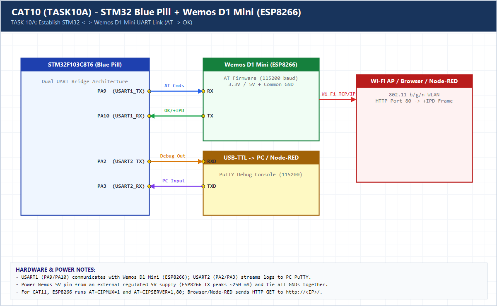

# EXPERIMENT DETAILS

**EXP:** CONTINUOUS ASSESSMENT 10 (CAT10)

**DATE:** 05/10/2026

**NAME OF EXP:** STM32-Wemos Wi-Fi Modem Interface Using AT Commands

**HARDWARE SETUP / PLATFORM:** CubeMX + Keil MDK + STM32F103C8T6 + Wemos D1 Mini (ESP8266)

---

## TASK 10A : Establish STM32 <-> Wemos UART Communication

### 1. Hardware Setup & Circuit Diagram

- STM32 `USART1` (`PA9/PA10`) <-> Wemos D1 Mini (`RX/TX`)
- STM32 `USART2` (`PA2/PA3`) <-> PC PuTTY
- Common GND + 5V/3.3V supply

### 2. Core Logic / Pseudocode / Code Base

**Working Principle:**

Sends `AT\r\n` from STM32 `USART1` to the Wemos D1 Mini ESP8266 modem, captures the modem response (`OK`), and forwards it over `USART2` to the PC terminal.

**Pseudocode:**

1. Initialize `USART1` (ESP8266) and `USART2` (PC).
2. Transmit `AT\r\n` on `USART1`.
3. Receive response on `USART1` and forward to `USART2`.

**Code Base:**

- Dual-UART bridge cleanly separates modem control traffic from PC debug output.

### 3. Inference

Receiving `OK` on the PC terminal confirms physical wiring, baud rate alignment (115200), and AT firmware readiness on the Wemos D1 Mini.
