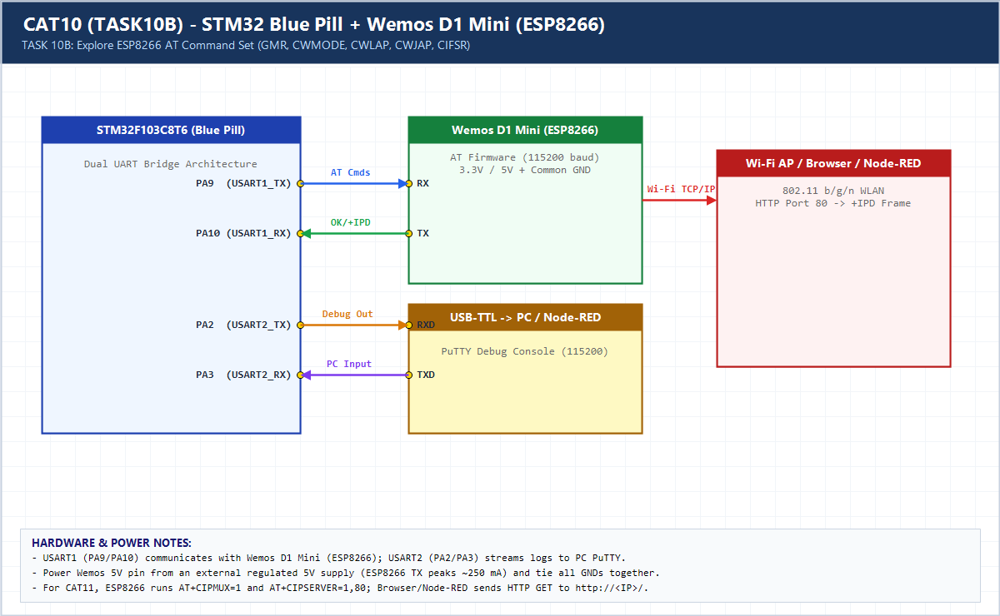

# EXPERIMENT DETAILS

**EXP:** CONTINUOUS ASSESSMENT 10 (CAT10)

**DATE:** 05/10/2026

**NAME OF EXP:** STM32-Wemos Wi-Fi Modem Interface Using AT Commands

**HARDWARE SETUP / PLATFORM:** CubeMX + Keil MDK + STM32F103C8T6 + Wemos D1 Mini (ESP8266)

---

## TASK 10B : Explore ESP8266 AT Command Interface

### 1. Hardware Setup & Circuit Diagram

- STM32F103C8T6 (`USART1` <-> Wemos D1 Mini, `USART2` <-> PC PuTTY)

### 2. Core Logic / Pseudocode / Code Base

**Working Principle:**

Probes core ESP8266 AT commands (`AT`, `AT+GMR` firmware version, `AT+CWMODE=1` station mode, `AT+CWLAP` AP scan) and prints modem replies to PuTTY.

**Pseudocode:**

1. Send `AT` to verify link.
2. Send `AT+GMR` for SDK/AT firmware version.
3. Send `AT+CWMODE=1` for station mode and `AT+CWLAP` to scan nearby SSIDs.

**Code Base:**

- `send_at_and_log()` automates request/response tracing across dual UARTs.

### 3. Inference

Command investigation establishes the full AT workflow (`AT`, `AT+GMR`, `AT+CWMODE`, `AT+CWLAP`, `AT+CWJAP`, `AT+CIFSR`, `AT+CIPSTART`, `AT+CIPSEND`).
