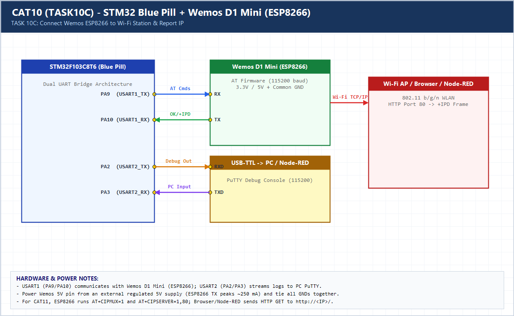

# EXPERIMENT DETAILS

**EXP:** CONTINUOUS ASSESSMENT 10 (CAT10)

**DATE:** 05/10/2026

**NAME OF EXP:** STM32-Wemos Wi-Fi Modem Interface Using AT Commands

**HARDWARE SETUP / PLATFORM:** CubeMX + Keil MDK + STM32F103C8T6 + Wemos D1 Mini (ESP8266)

---

## TASK 10C : Connect Wemos ESP8266 to Wi-Fi Network

### 1. Hardware Setup & Circuit Diagram

- STM32F103C8T6 (`USART1` <-> Wemos D1 Mini, `USART2` <-> PC PuTTY)

### 2. Core Logic / Pseudocode / Code Base

**Working Principle:**

Executes the full station join sequence (`AT` -> `AT+CWMODE=1` -> `AT+CWJAP` -> `AT+CIFSR`) and prints connection verification and assigned IPv4 address on PuTTY.

**Pseudocode:**

1. Verify modem with `AT`.
2. Set station mode `AT+CWMODE=1`.
3. Join AP via `AT+CWJAP` and query IP with `AT+CIFSR`.

**Code Base:**

- Reports `WIFI MODE : STATION`, `WIFI STATUS : CONNECTED`, and DHCP IP address over `USART2`.

### 3. Inference

The STM32 autonomously provisions the ESP8266 onto the local Wi-Fi network and retrieves its DHCP IP address.
