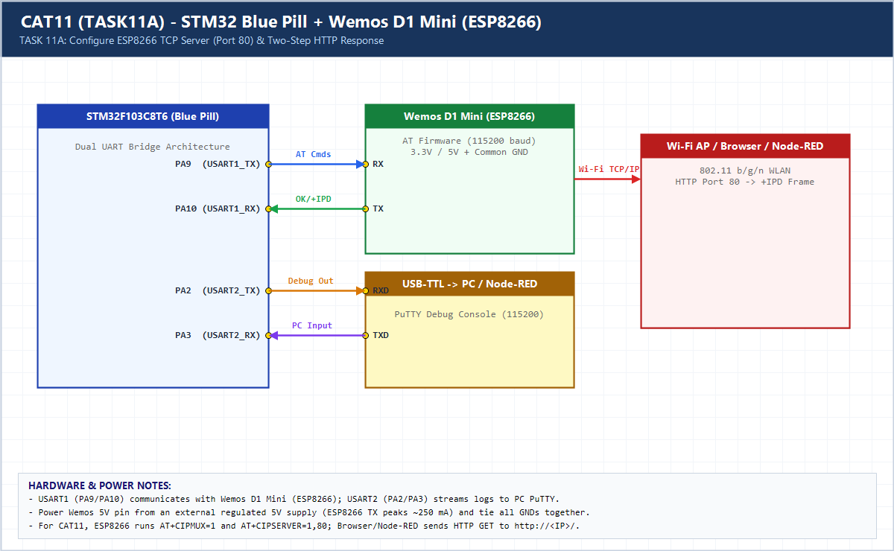

# EXPERIMENT DETAILS

**EXP:** CONTINUOUS ASSESSMENT 11 (CAT11 / 10C-10D)

**DATE:** 12/10/2026

**NAME OF EXP:** HTTP Server - STM32-Wemos Wi-Fi Modem Using AT Commands

**HARDWARE SETUP / PLATFORM:** CubeMX + Keil MDK + STM32F103C8T6 + Wemos D1 Mini + Browser

---

## TASK 11A : Configure ESP8266 TCP Server & Static HTTP Response

### 1. Hardware Setup & Circuit Diagram

- STM32F103C8T6 (`USART1` <-> Wemos D1 Mini, `USART2` <-> PC)
- HTTP Client: Web Browser on port 80

### 2. Core Logic / Pseudocode / Code Base

**Working Principle:**

Enables multi-connection TCP server (`AT+CIPMUX=1`, `AT+CIPSERVER=1,80`), parses incoming `+IPD,<link_id>,<len>:GET /` notifications, computes `Content-Length`, and sends a two-step `AT+CIPSEND` HTML response followed by `AT+CIPCLOSE`.

**Pseudocode:**

1. Send `AT+CIPMUX=1` and `AT+CIPSERVER=1,80`.
2. Wait for `+IPD,<link_id>,...` from browser.
3. Construct `HTTP/1.1 200 OK` response with exact `Content-Length`.
4. Issue `AT+CIPSEND=<link_id>,<len>`, wait for `>`, transmit HTTP response, and close connection.

**Code Base:**

- Two-step `AT+CIPSEND` protocol guarantees clean TCP framing for web browsers.

### 3. Inference

The STM32 acts as a lightweight embedded web server over serial AT commands, serving valid HTML pages to any browser on the LAN.
