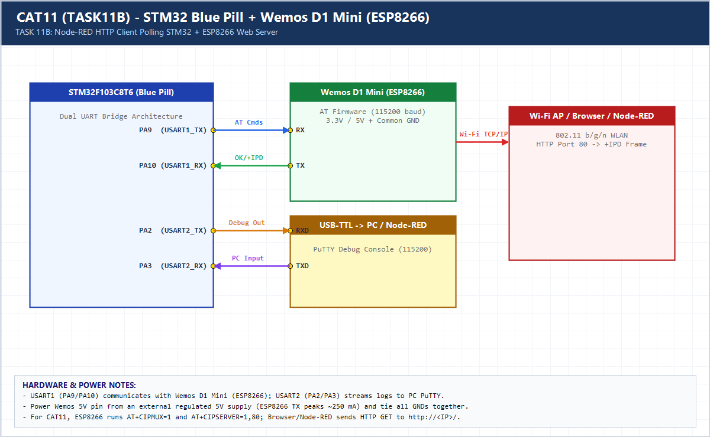

# EXPERIMENT DETAILS

**EXP:** CONTINUOUS ASSESSMENT 11 (CAT11 / 10E)

**DATE:** 12/10/2026

**NAME OF EXP:** HTTP Server - STM32-Wemos Wi-Fi Modem Using AT Commands

**HARDWARE SETUP / PLATFORM:** CubeMX + Keil MDK + STM32F103C8T6 + Wemos D1 Mini + Node-RED

---

## TASK 11B : Node-RED as HTTP Client of STM32/ESP8266 Server

### 1. Hardware Setup & Circuit Diagram

- STM32F103C8T6 + Wemos D1 Mini HTTP Server
- Node-RED Flow (`node_red_flow.json`): Inject -> HTTP Request (`http://<ESP8266_IP>/`) -> Debug

### 2. Core Logic / Pseudocode / Code Base

**Working Principle:**

Serves dynamic JSON uptime telemetry over HTTP port 80 so both a browser and a Node-RED `http request` node (`Inject -> HTTP Request -> Debug`) can poll the STM32 node.

**Pseudocode:**

1. Start ESP8266 TCP server on port 80.
2. On `+IPD` GET request, build JSON payload with `HAL_GetTick()`.
3. Respond with `Content-Type: application/json` and exact `Content-Length`.
4. Import `node_red_flow.json` into Node-RED to poll `http://<ESP8266_IP>/`.

**Code Base:**

- Includes ready-to-import `node_red_flow.json` matching the `Inject -> HTTP Request -> Debug` pipeline.

### 3. Inference

Node-RED integrates seamlessly as a second HTTP client alongside web browsers, enabling automated polling and dashboard integration.
