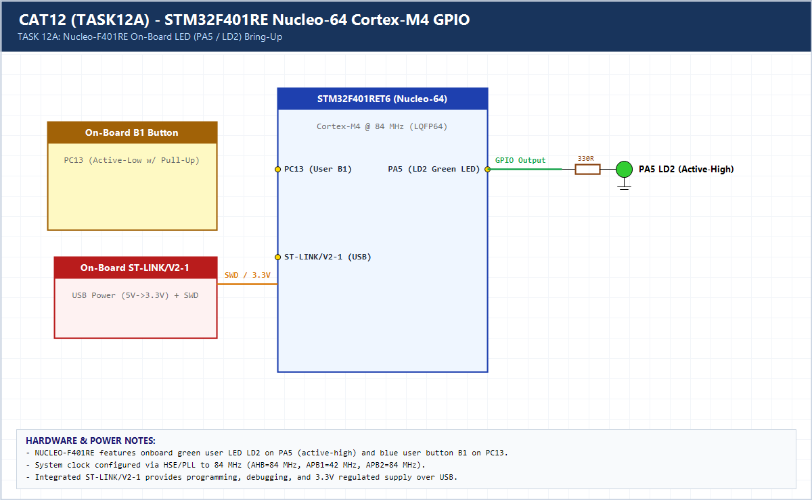

# EXPERIMENT DETAILS

**EXP:** CONTINUOUS ASSESSMENT 12 (CAT12 / 11)

**DATE:** 14/10/2026

**NAME OF EXP:** STM32F401RE Cortex-M4: GPIO and User Input Programming

**HARDWARE SETUP / PLATFORM:** CubeMX + Keil MDK + STM32 Nucleo-F401RE (Cortex-M4 @ 84 MHz)

---

## TASK 12A (Task 1) : On-board LED Bring-Up

### 1. Hardware Setup & Circuit Diagram

- STM32 `NUCLEO-F401RE` (`STM32F401RET6`, LQFP64)
- Clock: 84 MHz SYSCLK
- Onboard LED: `PA5` (LD2, active-high)

### 2. Core Logic / Pseudocode / Code Base

**Working Principle:**

Configures `PA5` as push-pull output and toggles the Nucleo-F401RE onboard green LED LD2 at a fixed 500 ms interval (`1 Hz`) to validate clock tree and GPIO output bring-up.

**Pseudocode:**

1. Initialize HAL, 84 MHz system clock, and `PA5` output.
2. In `while(1)`, call `HAL_GPIO_TogglePin(GPIOA, GPIO_PIN_5)` and `HAL_Delay(500)`.

**Code Base:**

- Matches CubeMX `LED_TOGGLE_F401RE` configuration for `STM32F401RET6`.

### 3. Inference

LD2 on `PA5` blinks steadily at 1 Hz, verifying ST-LINK flashing, 84 MHz PLL configuration, and Cortex-M4 GPIO control.
