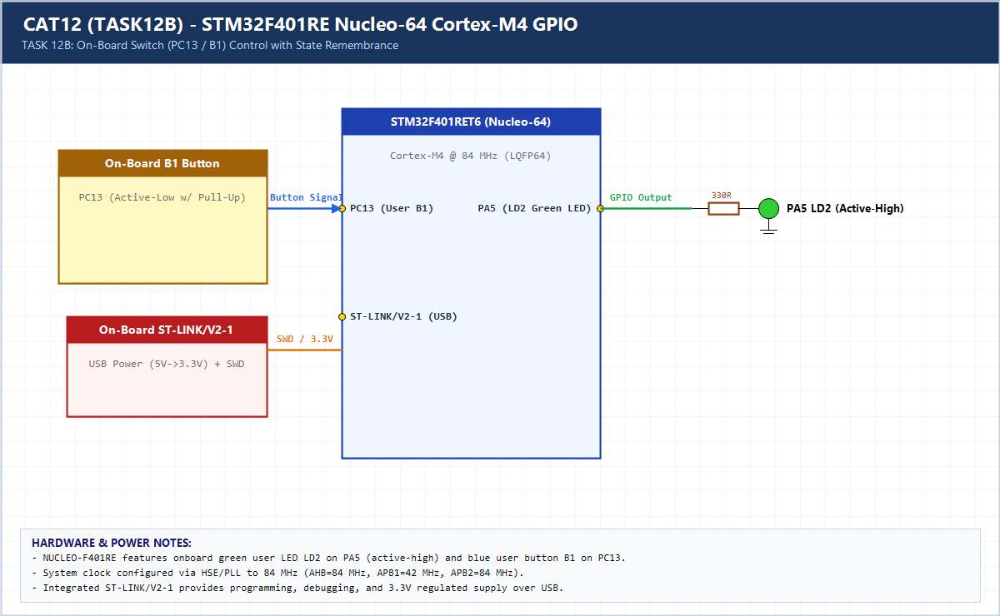

# EXPERIMENT DETAILS

**EXP:** CONTINUOUS ASSESSMENT 12 (CAT12 / 11)

**DATE:** 14/10/2026

**NAME OF EXP:** STM32F401RE Cortex-M4: GPIO and User Input Programming

**HARDWARE SETUP / PLATFORM:** CubeMX + Keil MDK + STM32 Nucleo-F401RE

---

## TASK 12B (Task 2) : On-board Switch Control with State Remembrance

### 1. Hardware Setup & Circuit Diagram

- STM32 `NUCLEO-F401RE`
- Onboard LED: `PA5` (LD2)
- Onboard User Button B1: `PC13` (Active-Low)

### 2. Core Logic / Pseudocode / Code Base

**Working Principle:**

Monitors Nucleo user button `B1` (`PC13`) with 50 ms debouncing and latches `led_state` on each valid press, retaining the toggled LED state after button release.

**Pseudocode:**

1. Read `PC13` and detect falling edge (`SET -> RESET`).
2. Apply 50 ms `HAL_GetTick()` debounce filter.
3. Invert `led_state` and write to `PA5`, preserving state when `PC13` is released.

**Code Base:**

- Stateful toggle latch using `led_state` and `prev_btn` edge tracking.

### 3. Inference

LD2 latches ON/OFF across button releases with zero bounce glitches.
