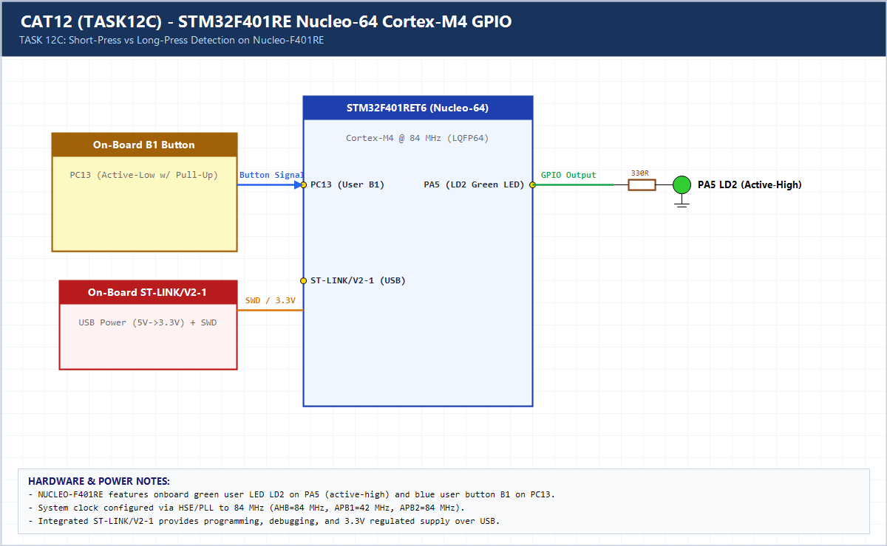

# EXPERIMENT DETAILS

**EXP:** CONTINUOUS ASSESSMENT 12 (CAT12 / 11)

**DATE:** 14/10/2026

**NAME OF EXP:** STM32F401RE Cortex-M4: GPIO and User Input Programming

**HARDWARE SETUP / PLATFORM:** CubeMX + Keil MDK + STM32 Nucleo-F401RE

---

## TASK 12C (Task 3) : Short-Press and Long-Press Detection

### 1. Hardware Setup & Circuit Diagram

- STM32 `NUCLEO-F401RE`
- User Button `PC13`
- User LED `PA5`

### 2. Core Logic / Pseudocode / Code Base

**Working Principle:**

Measures `PC13` press duration non-blockingly using `HAL_GetTick()`. Short press (`< 1000 ms`) toggles `PA5` or exits blink mode; long press (`>= 1000 ms`) activates 200 ms continuous blinking.

**Pseudocode:**

1. Timestamp button press on `PC13`.
2. On release, classify `< 1000 ms` as short press and `>= 1000 ms` as long press.
3. Execute distinct LED behaviors non-blockingly.

**Code Base:**

- Non-blocking `HAL_GetTick()` duration classifier on Cortex-M4.

### 3. Inference

Single-button multi-action UI works deterministically on Nucleo-F401RE without blocking system execution.
