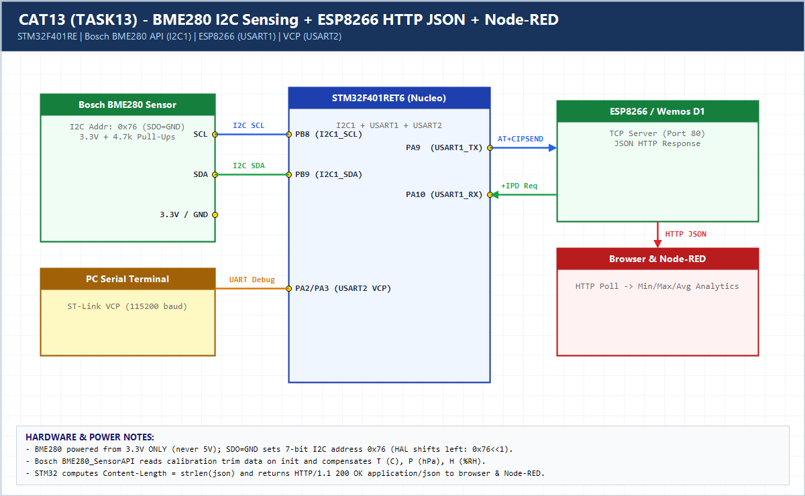

# EXPERIMENT DETAILS

**EXP:** CONTINUOUS ASSESSMENT 13 (CAT13 / 12)

**DATE:** 23/10/2026

**NAME OF EXP:** Sensor Interfacing (BME280) - STM32 (Debug) - ESP8266 (Wi-Fi) HTTP - Node Analytics

**HARDWARE SETUP / PLATFORM:** CubeMX + Keil MDK + STM32 Nucleo-F401RE + BME280 + ESP8266 + Node-RED

---

## TASK 13 : BME280 Sensor Interfacing Using I2C and Bosch Sensor API

### 1. Hardware Setup & Circuit Diagram

- STM32 `NUCLEO-F401RE`
- BME280 Sensor on `I2C1` (`PB8=SCL`, `PB9=SDA`, `0x76`, `3.3V`)
- ESP8266 on `USART1` (`PA9/PA10`)
- PC Debug on `USART2` (`PA2/PA3`)

### 2. Core Logic / Pseudocode / Code Base

**Working Principle:**

Integrates the official Bosch `BME280_SensorAPI` (`bme280.c`, `bme280.h`, `bme280_defs.h`) via STM32 HAL `I2C1` wrappers, prints compensated temperature/pressure/humidity over `USART2`, builds dynamic JSON with exact `Content-Length`, and serves it via ESP8266 to browser & Node-RED for Min/Max/Avg analytics.

**Pseudocode:**

1. Bind `user_i2c_read`, `user_i2c_write`, and `user_delay_us` to `struct bme280_dev`.
2. Call `bme280_init()` and configure 1x oversampling + normal mode.
3. Poll `bme280_get_sensor_data()` every 1 s.
4. Format JSON payload, calculate `strlen(json)`, and transmit HTTP response via `AT+CIPSEND`.

**Code Base:**

- Includes genuine Bosch `BME280_SensorAPI` files plus `node_red_flow.json` computing live Min/Max/Average analytics.

### 3. Inference

Bosch calibration compensation produces accurate environmental telemetry, while dynamic `Content-Length` HTTP framing enables real-time Node-RED statistical analytics.
