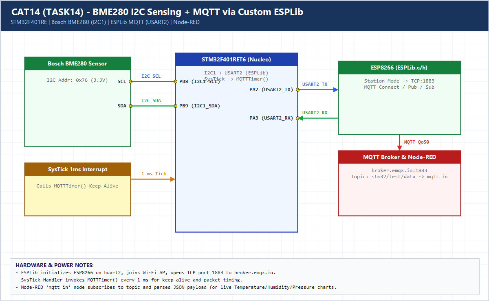

# EXPERIMENT DETAILS

**EXP:** CONTINUOUS ASSESSMENT 14 (CAT14 / 13)

**DATE:** 27/10/2026

**NAME OF EXP:** Sensor Interfacing (BME280) - (MQTT) - Node Analytics

**HARDWARE SETUP / PLATFORM:** CubeMX + Keil MDK + STM32 Nucleo-F401RE + BME280 + ESP8266 + EMQX MQTT + Node-RED

---

## TASK 14 : BME280 Sensor Interfacing Using I2C and MQTT using Custom Built ESP8266 API

### 1. Hardware Setup & Circuit Diagram

- STM32 `NUCLEO-F401RE`
- BME280 on `I2C1` (`PB8/PB9`, `0x76`)
- ESP8266 on `USART2` (`PA2/PA3`)
- MQTT Broker `broker.emqx.io:1883` -> Node-RED `mqtt in`

### 2. Core Logic / Pseudocode / Code Base

**Working Principle:**

Reads compensated BME280 sensor data over `I2C1`, formats the JSON payload, and publishes it over MQTT (`QoS0`) to `stm32/test/data` on `broker.emqx.io:1883` using the custom `ESPLib` driver (`ESP8266_Init`, `ESP8266_wifiConnect`, `ESP8266_portConnect`, `MQTT_connectBroker`, `MQTT_publishTopic`). `SysTick_Handler()` invokes `MQTTTimer()` every 1 ms.

**Pseudocode:**

1. Initialize BME280 on `I2C1` and ESP8266 via `ESP8266_Init(StationMode, huart2)`.
2. Join Wi-Fi and open TCP socket to `broker.emqx.io:1883`.
3. Send MQTT `CONNECT` packet via `MQTT_connectBroker()`.
4. Every 1 s, read BME280, construct JSON, and call `MQTT_publishTopic("stm32/test/data", json, QoS0)`.
5. Visualize live JSON messages in Node-RED using `mqtt in`.

**Code Base:**

- Custom `ESPLib.h` / `ESPLib.c` implements AT transport + MQTT 3.1.1 CONNECT/PUBLISH/SUBSCRIBE packet framing.
- `stm32f4xx_it.c` calls `MQTTTimer()` inside `SysTick_Handler()`.

### 3. Inference

Replacing HTTP polling with lightweight MQTT publish/subscribe decouples the STM32 sensor node from Node-RED and lowers network overhead.
