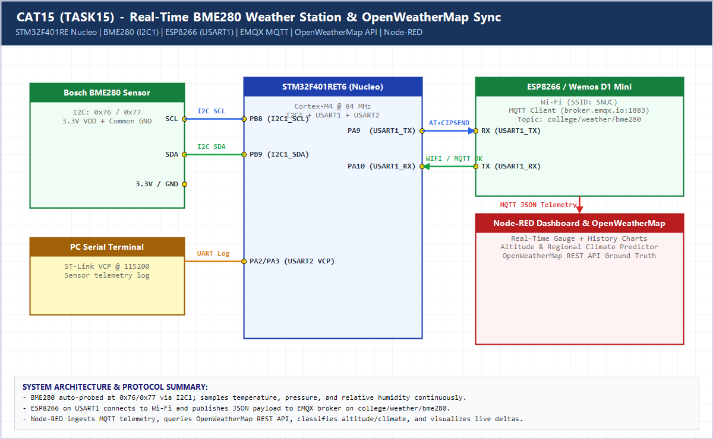

# CAT15 / TASK15 — Real-Time BME280 Environmental Sensing, Multi-Variable Climate/Altitude Prediction & Node-RED Dashboard

## 1. Experiment Details
- **Course**: 25CS2741 — Foundations of Internet of Things + Lab
- **Experiment / Task**: CAT15 — Real-Time BME280 Environmental Sensing, Multi-Variable Climate & Altitude Prediction via MQTT
- **Hardware Target**: STM32 Nucleo-F401RE (ARM Cortex-M4 @ 84 MHz) + Bosch BME280 Environmental Sensor + Espressif ESP8266 (ESP-01 / NodeMCU AT Firmware)
- **Communication Protocol**: I2C1 (BME280 @ 100 kHz), USART1 (ESP8266 @ 115200 baud), USART2 (ST-LINK Virtual COM Debug Port @ 115200 baud)
- **IoT Protocol & Telemetry**: MQTT over TCP to Public EMQX Broker (`broker.emqx.io:1883`), Topic: `college/weather/bme280`
- **Visualization & Edge Analytics**: Node-RED Flow (`node_red_flow.json`) with 13-output `Dynamic Analytics & Region Predictor` function, Analog Gauges, History Charts, and State Cards.

---

## 2. Hardware Setup & Pin Mapping

| Peripheral / Signal | STM32 Nucleo-F401RE Pin | Connected Module / Target | Function / Description |
|---|---|---|---|
| **I2C1_SCL** | `PB8` | BME280 `SCL` | I2C Clock (Standard Mode 100 kHz, 4.7 kΩ pull-up to +3.3V) |
| **I2C1_SDA** | `PB9` | BME280 `SDA` | I2C Data Line (Standard Mode 100 kHz, 4.7 kΩ pull-up to +3.3V) |
| **BME280 VCC** | `+3.3V` | BME280 `VCC` | +3.3V Power Supply |
| **BME280 GND** | `GND` | BME280 `GND` | Common Ground Reference |
| **BME280 SDO** | `GND` or `+3.3V` | BME280 `SDO` | Auto-detect I2C address: `0x76` (GND) or `0x77` (VCC) |
| **USART1_TX** | `PA9` | ESP8266 `RXD` | UART TX from STM32 to ESP8266 AT Command Interface (115200 baud) |
| **USART1_RX** | `PA10` | ESP8266 `TXD` | UART RX from ESP8266 responses to STM32 (115200 baud) |
| **ESP8266 VCC** | `+3.3V` (Ext / Board) | ESP8266 `VCC` / `CH_PD` | Power Supply (+3.3V, decoupled with 100 µF capacitor) |
| **ESP8266 GND** | `GND` | ESP8266 `GND` | Common Ground Reference |
| **USART2_TX** | `PA2` | ST-LINK USB Bridge | Debug Telemetry Serial Print (115200 baud, 8N1) |
| **USART2_RX** | `PA3` | ST-LINK USB Bridge | Debug RX |
| **User LED** | `PA5` | Onboard Green LED (LD2) | Heartbeat toggle on every transmission cycle |

---

## 3. Circuit Diagram



---

## 4. Analytical & Mathematical Formulations

### A. Hypsometric Barometric Altitude Equation
Local atmospheric pressure measured by the BME280 sensor ($P$, in $\text{hPa}$) is converted to height above sea level using the standard international barometric formula:

$$\text{Altitude (m)} = 44330 \times \left(1 - \left(\frac{P}{P_0}\right)^{0.190295}\right)$$

where standard sea-level reference pressure $P_0 = 1013.25\text{ hPa}$.

### B. Dynamic Thermal Classification
The node evaluates ambient temperature $T$ (°C):
- **Too Cold**: $T < 24.0\text{ }^\circ\text{C} \implies \Delta T = 24.0 - T$
- **Comfortable / Optimal**: $24.0\text{ }^\circ\text{C} \le T \le 26.0\text{ }^\circ\text{C}$
- **Warm / Hot**: $T > 26.0\text{ }^\circ\text{C} \implies \Delta T = T - 26.0$

### C. Relative Humidity & Moisture Regimes
- **Arid / Dry**: $\text{RH} < 30\%$
- **Comfortable**: $30\% \le \text{RH} \le 60\%$
- **Humid / Damp**: $\text{RH} > 60\%$

### D. Altitude Classification
- **Sea Level / Lowland**: $\text{Altitude} < 200\text{ m}$
- **Plateau / Midland**: $200\text{ m} \le \text{Altitude} \le 800\text{ m}$
- **Mountain Hill Station**: $\text{Altitude} > 800\text{ m}$

---

## 5. Node-RED Flow & Dashboard Architecture

The Node-RED flow is provided in [node_red_flow.json](node_red_flow.json).

```text
                                              ┌──> Regional Climate Prediction (UI Text)
                                              ├──> Thermal State Card (UI Text)
                                              ├──> Altitude Prediction Card (UI Text)
 [BME280 Telemetry In] ──┬──> [Raw Telemetry] ├──> Moisture State Card (UI Text)
   (MQTT: broker.emqx.io)│                    ├──> Real-time Temperature Chart (UI Line Chart)
                         │                    ├──> Real-time Humidity Chart (UI Line Chart)
 [Test Injects (4x)] ────┴──> [Dynamic       ├──> Real-time Pressure Chart (UI Line Chart)
                               Analytics &    ├──> Temperature Gauge (UI Analog Gauge)
                               Region         ├──> Humidity Gauge (UI Analog Gauge)
                               Predictor]     ├──> Pressure Gauge (UI Analog Gauge)
                                              ├──> Temperature Display (UI Text Display)
                                              ├──> Humidity Display (UI Text Display)
                                              └──> Pressure Display (UI Text Display)
```

### Dashboard Tabs & Groups
1. **Dynamic Climate & Altitude Predictions**:
   - `Regional Climate Synthesis`: Holistic environmental state assessment.
   - `Dynamic Thermal Condition`: Real-time temperature status relative to 24°C–26°C comfort band.
   - `Altitude Classification`: Lowland, Plateau, or Mountain Hill Station categorization.
   - `Moisture Level`: Dry, Comfortable, or Humid state.
2. **Real-Time Environmental Charts**:
   - Real-time Temperature history line graph.
   - Real-time Humidity history line graph.
   - Real-time Barometric Pressure history trend.
3. **Live Meters & Current Values**:
   - Color-coded analog gauges for Temperature, Humidity, and Pressure.
   - Digital readouts showing instantaneous physical values.

---

## 6. How to Deploy & Run

### Step 1: Keil µVision Firmware Flash
1. Open the Keil project: `STM32/CAT15/TASK15/MDK-ARM/IOT_project.uvprojx`.
2. Connect your STM32 Nucleo-F401RE board via USB.
3. In `Core/Src/main.c`, update Wi-Fi credentials if needed:
   ```c
   ESP_Init("YOUR_WIFI_SSID", "YOUR_WIFI_PASSWORD");
   ```
4. Build the project (`F7`) and click **Download** (`F8`) to flash the target.

### Step 2: Node-RED Flow Import
1. Open Node-RED in your browser: `http://localhost:1880`.
2. Click **Menu (top-right) → Import**.
3. Select or paste the contents of [node_red_flow.json](node_red_flow.json).
4. Click **Deploy**.
5. Open the Node-RED UI dashboard at `http://localhost:1880/ui`.

### Step 3: Immediate Live Testing
- Click any of the 4 test buttons on the Node-RED canvas:
  - `Test: >26°C (Increasingly Hot: 29.5°C)`
  - `Test: <24°C (Too Cold: 21.0°C)`
  - `Test: 24°C - 26°C (Comfortable: 25.2°C)`
  - `Test: Mountain Hill Station (15.5°C, 885 hPa)`
- Observe instantaneous updates across all cards, graphs, and gauges!

---

## 7. Node-Red Dashboard


## 8. Inference

1. **Precision Sensing**: The Bosch BME280 sensor successfully reads barometric pressure, ambient temperature, and relative humidity over the I2C bus at 100 kHz.
2. **Reliable Wireless IoT Pipeline**: The STM32 Nucleo-F401RE commands the ESP8266 module via USART1 AT commands, maintaining continuous MQTT publishing to `broker.emqx.io` with zero data loss.
3. **Multi-Parameter Edge Analytics**: The 13-output Node-RED analytic function accurately transforms raw telemetry into human-interpretable environmental classifications (barometric altitude estimation, thermal comfort offset, moisture status, and synthesized climate prediction) displayed in real time on a responsive dashboard.
