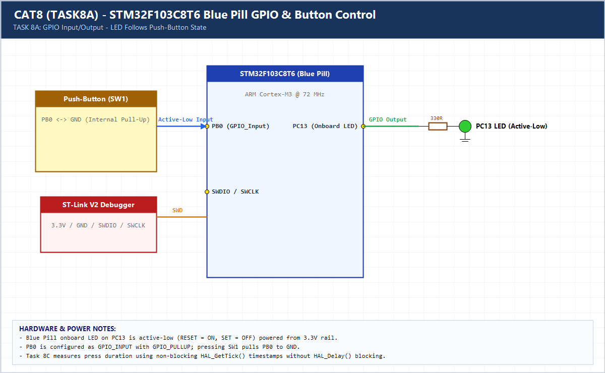

# EXPERIMENT DETAILS

**EXP:** CONTINUOUS ASSESSMENT 8 (CAT8)

**DATE:** 18/09/2026

**NAME OF EXP:** STM32 GPIO Bring-Up and Switch-Controlled LED

**HARDWARE SETUP / PLATFORM:** CubeMX + Keil MDK + STM32F103C8T6 (Blue Pill)

---

## TASK 8A : GPIO Input/Output (LED Follows Switch)

### 1. Hardware Setup & Circuit Diagram

- Blue Pill `STM32F103C8T6` (72 MHz)
- Onboard LED: `PC13` (Active-Low)
- Push-Button: `PB0` (`GPIO_PULLUP`, Active-Low)

### 2. Core Logic / Pseudocode / Code Base

**Working Principle:**

Reads digital input `PB0` using `HAL_GPIO_ReadPin()`. When pressed (`GPIO_PIN_RESET`), `PC13` is driven LOW to turn the onboard LED ON; when released, `PC13` is driven HIGH to turn the LED OFF.

**Pseudocode:**

1. Initialize HAL, 72 MHz clock, and GPIOs (`PC13` output, `PB0` input pull-up).
2. In `while(1)`, read `PB0`.
3. Mirror switch state directly onto `PC13`.

**Code Base:**

- Uses `HAL_GPIO_ReadPin()` and `HAL_GPIO_WritePin()` without blocking delays.

### 3. Inference

The PC13 LED responds instantaneously to the PB0 switch state, verifying STM32F103C8T6 GPIO input/output configuration.
