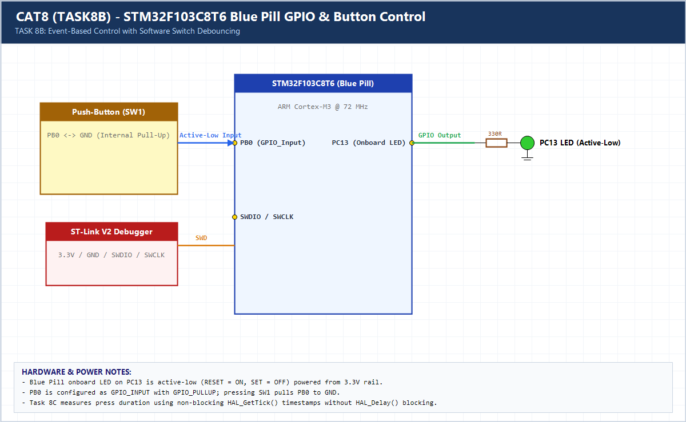

# EXPERIMENT DETAILS

**EXP:** CONTINUOUS ASSESSMENT 8 (CAT8)

**DATE:** 18/09/2026

**NAME OF EXP:** STM32 GPIO Bring-Up and Switch-Controlled LED

**HARDWARE SETUP / PLATFORM:** CubeMX + Keil MDK + STM32F103C8T6 (Blue Pill)

---

## TASK 8B : Event-Based Control with Software Debouncing

### 1. Hardware Setup & Circuit Diagram

- Blue Pill `STM32F103C8T6`
- Onboard LED: `PC13`
- Push-Button: `PB0` (`GPIO_PULLUP`)

### 2. Core Logic / Pseudocode / Code Base

**Working Principle:**

Detects falling-edge transitions on `PB0` and enforces a 50 ms `HAL_GetTick()` debounce guard so mechanical contact bounce never causes multiple toggles.

**Pseudocode:**

1. Track `prev_btn` and `last_debounce_ms`.
2. On `SET -> RESET` transition, check `(HAL_GetTick() - last_debounce_ms) > 50`.
3. Toggle `PC13` exactly once per valid press.

**Code Base:**

- `HAL_GPIO_TogglePin()` combined with `HAL_GetTick()` edge debouncing.

### 3. Inference

Edge detection plus 50 ms timestamp debouncing ensures one physical switch press reliably produces one LED toggle.
