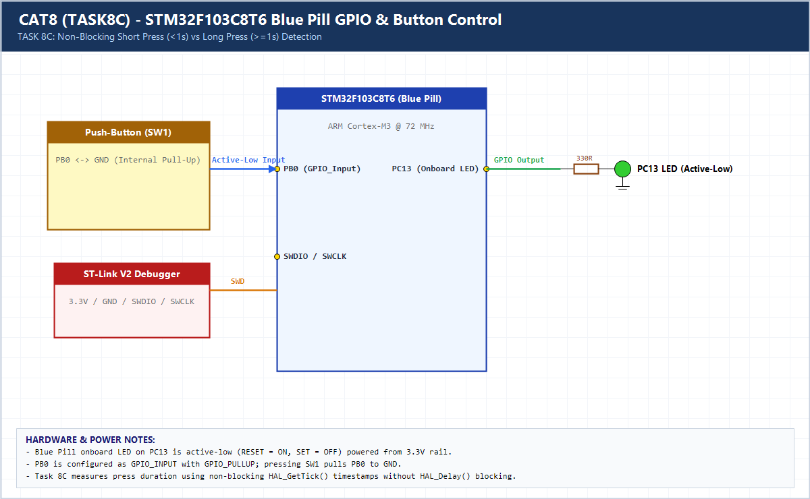

# EXPERIMENT DETAILS

**EXP:** CONTINUOUS ASSESSMENT 8 (CAT8)

**DATE:** 18/09/2026

**NAME OF EXP:** STM32 GPIO Bring-Up and Switch-Controlled LED

**HARDWARE SETUP / PLATFORM:** CubeMX + Keil MDK + STM32F103C8T6 (Blue Pill)

---

## TASK 8C : Short Press vs Long Press Detection (Non-Blocking)

### 1. Hardware Setup & Circuit Diagram

- Blue Pill `STM32F103C8T6`
- Onboard LED: `PC13`
- Push-Button: `PB0` (`GPIO_PULLUP`)

### 2. Core Logic / Pseudocode / Code Base

**Working Principle:**

Measures press duration non-blockingly via `press_start_ms = HAL_GetTick()` on press and `dur = now - press_start_ms` on release. Short press (`< 1000 ms`) toggles LED or exits blink mode; long press (`>= 1000 ms`) activates continuous 250 ms blinking.

**Pseudocode:**

1. Record `press_start_ms` on press edge.
2. On release edge, compute `dur = now - press_start_ms`.
3. If `dur >= 1000 ms`, enable `blink_mode`; else toggle LED or stop `blink_mode`.
4. Update non-blocking blink timer every 250 ms.

**Code Base:**

- Zero blocking `HAL_Delay()` calls during button measurement or LED blinking.

### 3. Inference

Timestamp subtraction via `HAL_GetTick()` classifies short vs long presses accurately while keeping the main loop completely non-blocking.
