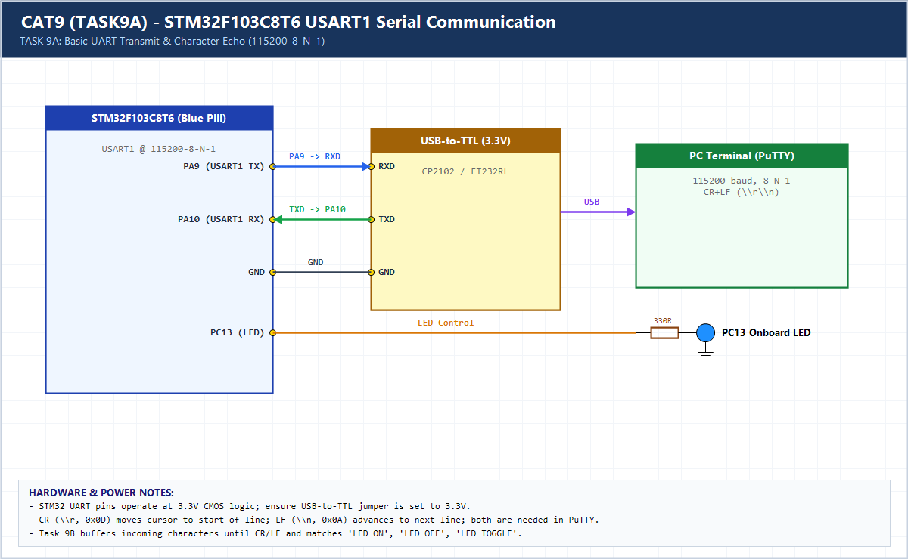

# EXPERIMENT DETAILS

**EXP:** CONTINUOUS ASSESSMENT 9 (CAT9)

**DATE:** 28/09/2026

**NAME OF EXP:** STM32 UART Command Controlled LED

**HARDWARE SETUP / PLATFORM:** CubeMX + Keil MDK + STM32F103C8T6 + USB-TTL + PuTTY

---

## TASK 9A : Basic UART Communication & Character Echo

### 1. Hardware Setup & Circuit Diagram

- Blue Pill `STM32F103C8T6`
- `USART1`: `PA9` (TX) -> USB-TTL `RXD`, `PA10` (RX) <- USB-TTL `TXD`, `115200-8-N-1`

### 2. Core Logic / Pseudocode / Code Base

**Working Principle:**

Initializes `USART1` at 115200-8-N-1, transmits `HELLO\r\nWORLD\r\n` to demonstrate Carriage Return (`\r`) + Line Feed (`\n`), and echoes every received byte back to PuTTY.

**Pseudocode:**

1. Initialize `USART1` (`115200-8-N-1`).
2. Transmit startup CR+LF test banner.
3. Poll `HAL_UART_Receive()` and immediately transmit received byte back via `HAL_UART_Transmit()`.

**Code Base:**

- `\r` returns cursor to column 0 while `\n` moves down one line; both are required for clean PuTTY line formatting.

### 3. Inference

Verified bidirectional STM32-to-PC serial communication and confirmed why both CR and LF control characters are required in terminal emulators.
