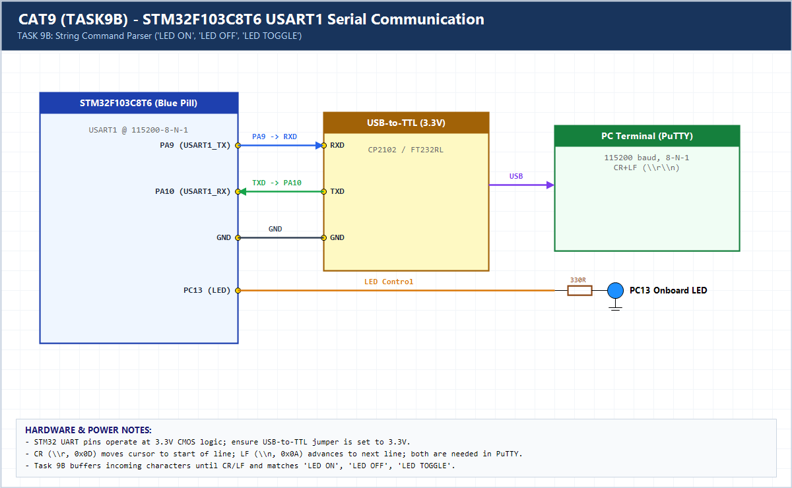

# EXPERIMENT DETAILS

**EXP:** CONTINUOUS ASSESSMENT 9 (CAT9)

**DATE:** 28/09/2026

**NAME OF EXP:** STM32 UART Command Controlled LED

**HARDWARE SETUP / PLATFORM:** CubeMX + Keil MDK + STM32F103C8T6 + USB-TTL + PuTTY

---

## TASK 9B : String-Based Application Logic (LED ON / OFF / TOGGLE)

### 1. Hardware Setup & Circuit Diagram

- Blue Pill `STM32F103C8T6`
- `USART1` (`PA9/PA10`) <-> PC PuTTY
- Onboard LED `PC13`

### 2. Core Logic / Pseudocode / Code Base

**Working Principle:**

Accumulates incoming ASCII bytes until `\r` or `\n`, matches `LED ON`, `LED OFF`, or `LED TOGGLE` via `strcmp()`, drives `PC13`, and returns confirmation text.

**Pseudocode:**

1. Buffer received characters until CR/LF.
2. Null-terminate string and compare against `LED ON`, `LED OFF`, `LED TOGGLE`.
3. Execute corresponding GPIO action and transmit confirmation message.

**Code Base:**

- Demonstrates command-line framing over UART using `HAL_UART_Receive()` and `strcmp()`.

### 3. Inference

Command framing over UART transforms raw serial bytes into an interactive embedded CLI for actuator control.
